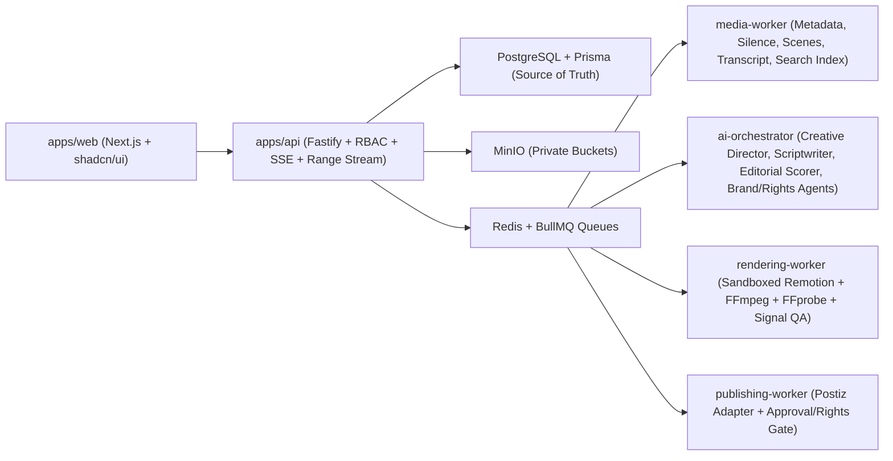

# Phase SOTA — Target System Architecture

**Date**: 2026-11-22  
**Design Principle**: Extend the existing monorepo (`apps/web`, `apps/api`, `apps/workers`, `packages/*`) cleanly without unnecessary microservices or AGPL dependencies.

---

## 1. Logical Domain Architecture (Inside Existing Monorepo)

## 2. Additive Prisma Schema Extensions (Stage 2–7)

All additions remain forward-compatible, workspace-scoped (`workspaceId` indexed), and migrated exclusively via Prisma:
1. **`MediaRightsRecord`** (Stage 2): `id`, `workspaceId`, `assetId`, `sourceType` (`USER_OWNED | LICENSED_STOCK | AI_GENERATED | VOICE_CLONED`), `licenseName`, `commercialAllowed`, `attributionRequired`, `attributionText`, `consentDocumentRef`, `expiresAt`, `verifiedByUserId`.
2. **`BudgetPolicy`** (Stage 2): `id`, `workspaceId`, `projectId?`, `monthlyLimitUsd`, `perRunLimitUsd`, `enforceHardStop`, `alertThresholdPct`.
3. **`ExternalReviewLink`** (Stage 6): `id`, `workspaceId`, `compositionId`, `tokenHash`, `label`, `allowComments`, `allowApproval`, `expiresAt`, `revokedAt`, `createdByUserId`.
4. **`Campaign` & `CampaignDeliverable`** (Stage 7): `id`, `workspaceId`, `projectId`, `title`, `objective`, `durationDays`, `status`, `pillarsJson`, `budgetUsd`, linked `Composition` / `PublishPost` records.

## 3. Specialized Agent & Middleware Pattern (Inspired by Apache-2.0 `FireRed-OpenStoryline`)

- **Storyline Context Middleware**: Summarizes prior agent outputs, active `BrandKit` style profile, and `MediaRightsRecord` constraints into bounded JSON context before invoking each specialist agent.
- **Anti-Slop Pre-Render Gate**: `CreativeDirectorAgent` -> 3 ranked concepts -> `EditorialQualityScorer` (10 dimensions: hook strength, narrative clarity, specificity, originality, pacing, visual variety, brand fit, audio plan, caption readability, factual grounding) -> human approval -> `VideoProductionAgent` -> `rendering-worker`.
- **Independent Verification Gate**: `ffprobe` (H.264/yuv420p/AAC) + FFmpeg signal QA (`blackdetect`, `freezedetect`, `silencedetect`, `ebur128`) + `BrandComplianceAgent` + `RightsGate` before unlocking `APPROVED` / `SCHEDULED` / `PUBLISHED`.
