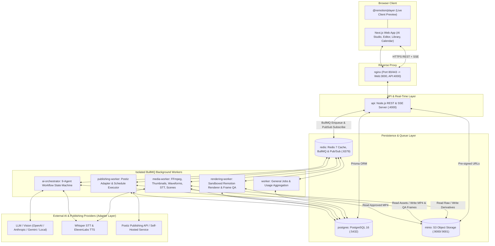
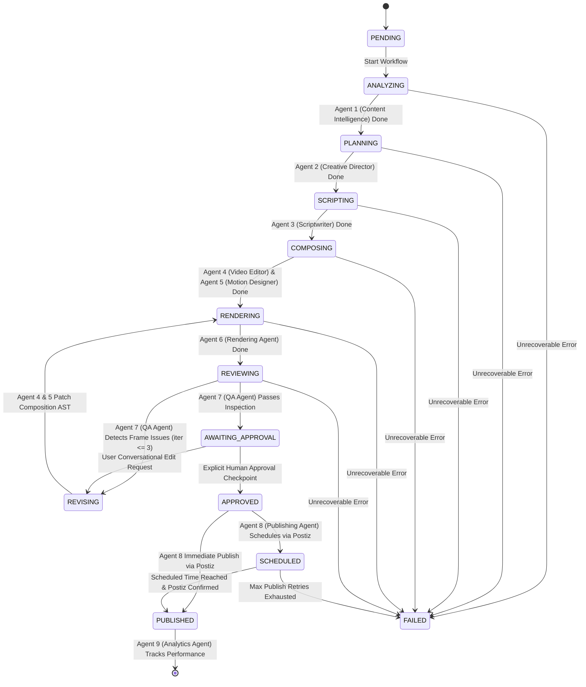

# System Architecture Specification (`docs/ARCHITECTURE.md`)

## 1. Repository Inspection & Project Classification

- **Inspection Result**: The workspace directory `c:\Users\user\Desktop\AI -Content-Studio` was inspected and confirmed to be an empty greenfield directory (`0` existing application files).
- **Host Environment Verified**:
  - OS: Windows 10/11 x64
  - Node.js: `v24.20.0`
  - npm: `11.19.0` (invoked via `npm.cmd` / `npx.cmd` in PowerShell due to Windows PowerShell `.ps1` execution policy)
  - Corepack: `0.35.0`
  - Docker Engine: `29.7.2` (daemon active and responsive)
  - Docker Compose: `v5.5.1`
  - Git: `2.55.0.windows.5`
- **Project Type**: Greenfield Production Monorepo.

---

## 2. System Architecture Diagram



---

## 3. Monorepo Folder Structure

```text
ai-content-studio/
├── .agents/
│   ├── rules/
│   │   ├── system-architecture.md
│   │   ├── coding-conventions.md
│   │   ├── typescript-standards.md
│   │   ├── docker-conventions.md
│   │   ├── database-migration-rules.md
│   │   ├── security-requirements.md
│   │   ├── testing-requirements.md
│   │   └── documentation-standards.md
│   └── skills/
│       ├── project-architecture/SKILL.md
│       ├── frontend-engineering/SKILL.md
│       ├── backend-engineering/SKILL.md
│       ├── docker-devops/SKILL.md
│       ├── remotion-video-engineering/SKILL.md
│       ├── ai-agent-orchestration/SKILL.md
│       ├── database-engineering/SKILL.md
│       ├── security-auditing/SKILL.md
│       ├── testing-qa/SKILL.md
│       └── external-api-integrations/SKILL.md
├── apps/
│   ├── web/                           # Service 1: frontend (Next.js App Router)
│   │   ├── src/
│   │   │   ├── app/                   # Routes: /dashboard, /library, /studio/[projectId], /editor/[compositionId], /repurpose, /publish, /calendar, /brand-kit, /admin
│   │   │   ├── components/            # shadcn/ui + studio, timeline, player, calendar components
│   │   │   ├── hooks/                 # useWorkflowStream (SSE), useCompositionHistory, useAuth
│   │   │   └── lib/                   # Typed API client, SSE subscriber, formatters
│   │   ├── package.json
│   │   └── tsconfig.json
│   ├── api/                           # Service 2: api (Node.js TypeScript REST + SSE server)
│   │   ├── src/
│   │   │   ├── routes/                # auth, workspaces, brand-kits, projects, assets, conversations, workflows, compositions, renders, publishing, calendar, analytics, health
│   │   │   ├── middleware/            # authGuard, rbacGuard, rateLimiter, zodValidator, errorHandler, auditLogger
│   │   │   ├── services/              # Domain services orchestrating DB & BullMQ queues
│   │   │   ├── sse/                   # Redis Pub/Sub to Server-Sent Events broadcaster
│   │   │   └── index.ts
│   │   ├── package.json
│   │   └── tsconfig.json
│   └── workers/                       # Services 5, 6, 7, 8, 9: BullMQ worker processes
│       ├── src/
│       │   ├── worker.ts              # General maintenance, usage quota rollups, webhook retries
│       │   ├── ai-orchestrator.ts     # 9-Agent workflow state machine coordinator
│       │   ├── media-worker.ts        # Asset ingestion, FFmpeg probe, thumbnails, waveforms, STT, scene extraction
│       │   ├── rendering-worker.ts    # Isolated Remotion bundler/renderer & QA frame sampler
│       │   ├── publishing-worker.ts   # Scheduled & immediate Postiz publishing executor
│       │   └── agents/                # 9 specialized agent implementations
│       │       ├── content-intelligence.agent.ts
│       │       ├── creative-director.agent.ts
│       │       ├── scriptwriter.agent.ts
│       │       ├── video-editor.agent.ts
│       │       ├── motion-designer.agent.ts
│       │       ├── rendering.agent.ts
│       │       ├── quality-assurance.agent.ts
│       │       ├── publishing.agent.ts
│       │       └── analytics.agent.ts
│       ├── package.json
│       └── tsconfig.json
├── packages/
│   ├── shared/                        # Shared Zod schemas, DTOs, Composition AST, enums, constants
│   ├── database/                      # Prisma schema, migrations, client singleton, encryption helpers, seed
│   ├── ai-providers/                  # Unified LLM, Vision, STT, TTS, ImageGen, Embedding abstraction + token/cost tracker
│   ├── remotion-engine/               # Declarative Composition AST compiler, 16 design components, 9 templates
│   └── integrations/                  # S3/MinIO storage adapter, Postiz adapter, MCP vision/media adapters
├── docker/
│   ├── web.Dockerfile
│   ├── api.Dockerfile
│   ├── worker.Dockerfile
│   ├── rendering-worker.Dockerfile
│   └── nginx/
│       └── nginx.conf
├── docs/
├── docker-compose.yml
├── docker-compose.prod.yml
├── .env.example
├── .dockerignore
├── Makefile
├── package.json
└── tsconfig.base.json
```

---

## 4. Docker Services & Networking Architecture

All 11 required services are orchestrated via Docker Compose across 3 segmented bridge networks:

### 4.1 Network Segmentation
1. `edge-network`: Connects `nginx`, `frontend`, and `api`. Only `nginx` (or `frontend`/`api` in dev) binds to host ports.
2. `backend-network`: Connects `api`, `worker`, `ai-orchestrator`, `media-worker`, `publishing-worker`, `postgres`, `redis`, and `minio`.
3. `render-sandbox-network` (`internal: true` in production): Connects `rendering-worker` strictly to `redis`, `postgres`, and `minio` without unrestricted outbound internet access.

### 4.2 Service Specification Matrix

| # | Service Name | Base Image / Build | Internal Port | Networks | Resource Limits (Prod) | Health Check |
|---|--------------|--------------------|---------------|----------|------------------------|--------------|
| 1 | `frontend` | `docker/web.Dockerfile` (Node 22 Alpine multi-stage) | `3000` | `edge-network` | 1 CPU, 1GB RAM | `wget -qO- http://localhost:3000/api/health` |
| 2 | `api` | `docker/api.Dockerfile` (Node 22 Alpine multi-stage) | `4000` | `edge-network`, `backend-network` | 2 CPU, 2GB RAM | `wget -qO- http://localhost:4000/api/health` |
| 3 | `postgres` | `postgres:16-alpine` | `5432` | `backend-network`, `render-sandbox-network` | 2 CPU, 4GB RAM | `pg_isready -U $POSTGRES_USER -d $POSTGRES_DB` |
| 4 | `redis` | `redis:7-alpine` | `6379` | `backend-network`, `render-sandbox-network` | 1 CPU, 1GB RAM | `redis-cli ping` |
| 5 | `worker` | `docker/worker.Dockerfile` (`WORKER_ROLE=general`) | `4010` | `backend-network` | 1 CPU, 1GB RAM | `wget -qO- http://localhost:4010/health` |
| 6 | `ai-orchestrator` | `docker/worker.Dockerfile` (`WORKER_ROLE=orchestrator`) | `4011` | `backend-network` | 2 CPU, 2GB RAM | `wget -qO- http://localhost:4011/health` |
| 7 | `media-worker` | `docker/worker.Dockerfile` + `ffmpeg` (`WORKER_ROLE=media`) | `4012` | `backend-network` | 2 CPU, 4GB RAM | `wget -qO- http://localhost:4012/health` |
| 8 | `rendering-worker` | `docker/rendering-worker.Dockerfile` (Node 22 + Chromium + FFmpeg, non-root sandbox) | `4013` | `render-sandbox-network` | 4 CPU, 8GB RAM | `wget -qO- http://localhost:4013/health` |
| 9 | `publishing-worker` | `docker/worker.Dockerfile` (`WORKER_ROLE=publishing`) | `4014` | `backend-network` | 1 CPU, 1GB RAM | `wget -qO- http://localhost:4014/health` |
| 10 | `minio` | `minio/minio:latest` | `9000`, `9001` | `backend-network`, `render-sandbox-network` | 2 CPU, 2GB RAM | `mc ready local` / HTTP `/minio/health/live` |
| 11 | `nginx` | `nginx:1.27-alpine` | `80`, `443` | `edge-network` | 1 CPU, 512MB RAM | `wget -qO- http://localhost:80/healthz` |

---

## 5. AI Provider Abstraction Layer (`packages/ai-providers`)

To avoid vendor lock-in and support automatic failover, all AI operations route through standardized interfaces:

```typescript
export interface LLMGenerationRequest<TSchema extends z.ZodTypeAny> {
  workspaceId: string;
  workflowId?: string;
  agentName: AgentType;
  systemPrompt: string;
  userPrompt: string;
  responseSchema?: TSchema; // Enforces structured JSON output
  temperature?: number;
  maxTokens?: number;
  timeoutMs?: number;
}

export interface AIProviderRegistry {
  llm: LLMProvider;           // OpenAI, Anthropic, Google Gemini, SimulatedDevProvider
  vision: VisionProvider;     // Gemini Vision, GPT-4o Vision, remotion-vision-mcp adapter
  stt: STTProvider;           // OpenAI Whisper API, Local Whisper-cpp/Faster-Whisper, SimulatedSTT
  tts: TTSProvider;           // ElevenLabs API, OpenAI TTS, SimulatedTTS
  imageGen: ImageGenProvider; // remotion-media-mcp / Imagen / Flux / SimulatedImageGen
  embeddings: EmbeddingProvider; // text-embedding-3-small / Gemini text-embedding-004
}
```

### Built-In Capabilities
- **Structured JSON Validation**: Every LLM response is parsed against the caller's Zod schema (`responseSchema`). If validation fails, the provider performs up to 2 automatic schema-repair retries before escalating.
- **Resilience & Failover**: Configurable primary and fallback providers (`AI_PRIMARY_LLM_PROVIDER=gemini`, `AI_FALLBACK_LLM_PROVIDER=openai`, plus `simulated` fallback when no external API keys are present in local development).
- **Observability & Quotas**: Every call records `promptTokens`, `completionTokens`, `latencyMs`, and `estimatedCostUsd` to the `UsageRecord` and `AgentRun` tables, checking workspace quota limits before execution.

---

## 6. Multi-Agent Orchestration & Workflow Engine

### 6.1 Persistent State Machine



### 6.2 The 9 Specialized Agents

| # | Agent | Stage | Input | Structured Output (`Zod` Validated) |
|---|-------|-------|-------|-------------------------------------|
| 1 | **Content Intelligence Agent** | `ANALYZING` | Raw Project Assets, Transcripts, Scene Cuts | `AssetIntelligenceReport` (speaker map, hook candidates, B-roll segments, sentiment, visual tags) |
| 2 | **Creative Director Agent** | `PLANNING` | User Prompt, `AssetIntelligenceReport`, `BrandKit` | `CreativeProductionPlan` (target platforms, deliverable count, pacing strategy, aspect ratios, creative brief per video) |
| 3 | **Scriptwriter Agent** | `SCRIPTING` | `CreativeProductionPlan`, Transcript Segments | `VideoScriptSpec` (0-3s hook, scene-by-scene narration/clip timecodes, word-synced caption tokens, CTA text) |
| 4 | **Video Editor Agent** | `COMPOSING` / `REVISING` | `VideoScriptSpec`, Asset References | `CompositionSceneGraph` (timeline tracks, video/audio trim trims, split-screen or talking-head layout bindings) |
| 5 | **Motion Designer Agent** | `COMPOSING` / `REVISING` | `CompositionSceneGraph`, `BrandKit` | Complete `CompositionSpec` JSON AST (kinetic typography, spring transitions, lower thirds, progress bar, sound wave, safe zones) |
| 6 | **Rendering Agent** | `RENDERING` | Validated `CompositionVersion` ID | `RenderArtifactResult` (MP4 S3 key, duration, resolution, extracted QA inspection frame PNGs at key timestamps) |
| 7 | **Quality Assurance Agent** | `REVIEWING` | Extracted QA Frame PNGs + `CompositionSpec` | `QaInspectionReport` (`passed: boolean`, `score: 0-100`, detected defects: `TEXT_OVERFLOW`, `BAD_CONTRAST`, `EMPTY_FRAME`, `CAPTION_MISALIGNMENT`, plus structured `RevisionPatchInstruction[]`) |
| 8 | **Publishing Agent** | `SCHEDULED` / `PUBLISHED` | Approved `RenderJob`, `SocialAccount[]`, Schedule Config | `PostizPublishResult` (platform post IDs, platform-tailored captions/hashtags, scheduled timestamps, status) |
| 9 | **Analytics Agent** | Post-`PUBLISHED` / Dashboard | Published Post Metrics & Historical Workspace Data | `AnalyticsRecommendationReport` (hook retention analysis, optimal posting windows, winning template recommendations) |

---

## 7. Remotion Video Composition & Editing Architecture (`packages/remotion-engine`)

### 7.1 Declarative JSON Composition AST (No Untrusted Code Eval)
Instead of allowing LLMs to write arbitrary React/TypeScript files that could crash builds or introduce remote code execution (RCE) vulnerabilities, all video compositions are represented by a deterministic, versioned JSON AST (`CompositionSpec`):

- **Metadata**: `width`, `height`, `fps`, `durationInFrames`, `aspectRatio` (`9:16` | `16:9` | `1:1` | `4:5`), `templateId`
- **Brand Tokens**: `primaryColor`, `secondaryColor`, `accentColor`, `fontFamilyHeading`, `fontFamilyBody`, `logoAssetUrl`, `captionPreset`
- **Tracks**:
  - `videoTrack`: Ordered scenes with asset signed URLs / keys, `startFrame`, `durationInFrames`, `trimBeforeFrames`, `trimAfterFrames`, `layout` (`talking-head`, `podcast-split`, `b-roll-overlay`, `full-bleed`)
  - `overlayTrack`: Component primitives from the 16-component design system (`AnimatedHeadline`, `KineticTypography`, `WordSyncedCaptions`, `LowerThird`, `ProgressBar`, `ChartGraphic`, `CallToAction`, `LogoBug`, `SoundWave`)
  - `transitionTrack`: Transitions between scenes (`spring-slide`, `fade`, `zoom-punch`, `glitch`, `whip-pan`)
  - `audioTrack`: Primary dialogue audio + ducked background music track (`volume`, `fadeInFrames`, `fadeOutFrames`)

### 7.2 Partial Conversational Editing & Undo/Redo
When a user says *"Make the first three seconds have a stronger hook and make captions larger"*:
1. The AI Editor produces a structured `CompositionPatchOperation[]` (e.g., `UPDATE_SCENE` on `scenes[0]`, `UPDATE_CAPTION_STYLE` with `fontSize: 64`).
2. The patch engine applies the operations to `CompositionVersion(N)` and validates the resulting JSON against `CompositionSpecSchema`.
3. A new immutable row `CompositionVersion(N+1)` is saved in PostgreSQL with `parentVersionId = N`, `changeSummary`, and `createdBy` (`AI_AGENT` or `USER`).
4. Undo/Redo simply moves `Composition.currentVersionId` backward or forward across the version tree and immediately updates `@remotion/player` in the browser.

---

## 8. Postiz Social Publishing Integration Architecture (`packages/integrations`)

- **Adapter Interface (`PublishingProvider`)**:
  - `getAuthUrl(platform, redirectUri, state)`
  - `exchangeCodeForToken(platform, code)`
  - `uploadMedia(accountCredentials, mediaStreamOrUrl, mimeType)`
  - `createOrSchedulePost(request: PublishPostRequest, idempotencyKey: string)`
  - `getPostStatus(externalPostId: string)`
- **Credential Encryption**: OAuth `accessToken` and `refreshToken` are encrypted with AES-256-GCM before storage in `SocialAccount.encryptedAccessToken` and `SocialAccount.encryptedRefreshToken`.
- **Approval Gate Enforcement**: `PublishingService.scheduleOrPublish()` verifies `Workflow.stage === 'APPROVED'` (or an active `Workspace.autoPublishApprovedPolicy === true` flag) at the database transaction layer before dispatching any job to `publishing-worker`.

---

## 9. Key Technical Decisions & Risk Register

| ID | Risk / Challenge | Technical Decision & Mitigation |
|----|------------------|---------------------------------|
| **R-01** | **Arbitrary AI Code Execution Risk in Remotion** | Do not execute raw AI-generated `.tsx` source code. Use a strict Zod-validated JSON Composition AST compiled into pre-audited Remotion components inside a capability-dropped `rendering-worker` container. |
| **R-02** | **License Conflicts Across Reference Repos** | Do not vendor GPL/AGPL or restrictive source directly into the core monorepo. Implement clean-room TypeScript motion primitives in `packages/remotion-engine` inspired by MIT/Apache-2.0 patterns (`IBM/chuk-motion`, `Remocn/remocn`, `instincthub/remotion-create-video`, `haidrrrry/claude-remotion-skill`) and connect to Postiz via HTTP REST API. Note Remotion's Company License requirement for commercial teams >3 people in `docs/INTEGRATIONS.md`. |
| **R-03** | **Long-Running Video Renders Blocking API / Lost on Refresh** | Offload all media and rendering tasks to dedicated BullMQ queues (`media-queue`, `orchestrator-queue`, `render-queue`, `publish-queue`). Broadcast progress via Redis Pub/Sub -> SSE and persist state in PostgreSQL so page reloads recover full progress immediately. |
| **R-04** | **Duplicate Social Posts on Worker Crash/Retry** | Compute deterministic `idempotencyKey = sha256(publishPostId + socialAccountId + scheduledAt)` and check `PublishAttempt` table before invoking Postiz API. |
| **R-05** | **Missing External API Keys in Local Dev / CI** | Provide a transparent Provider Fallback Layer (`SimulatedProviderAdapter`) that executes full DB/Queue state transitions, generates real valid test MP4/audio/frame assets via FFmpeg/Remotion, and labels simulated AI responses with `[SIMULATED]`. |
| **R-06** | **Windows Host PowerShell `.ps1` Execution Policy** | Use `npm.cmd` and `npx.cmd` when running commands on the Windows host shell, and run services inside Linux Docker containers for parity. |
