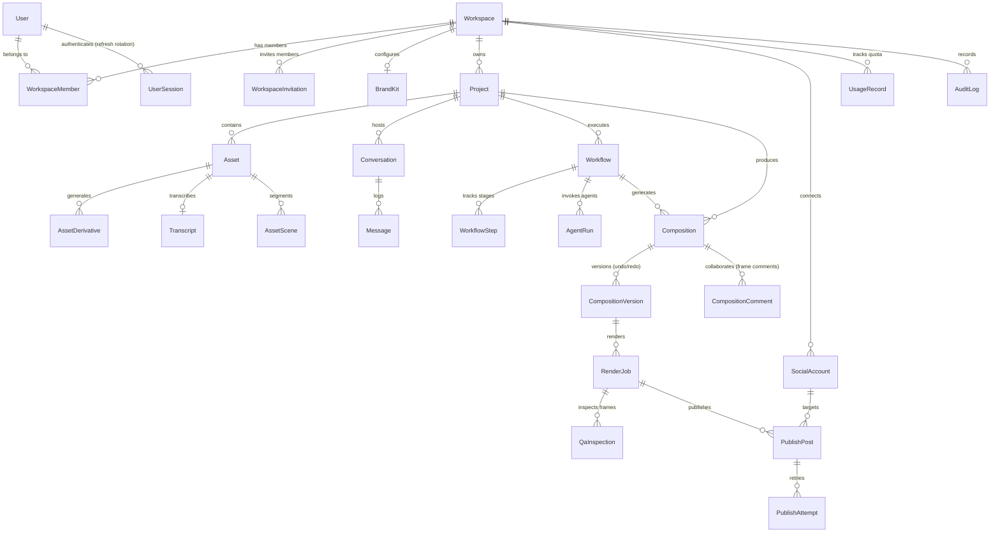

# Database Schema & Entity Relationship Specification (`docs/DATABASE_SCHEMA.md`)

## 1. Entity Relationship Diagram (ERD)



---

## 2. Complete Prisma Schema (`packages/database/prisma/schema.prisma`)

```prisma
generator client {
  provider = "prisma-client-js"
}

datasource db {
  provider = "postgresql"
  url      = env("DATABASE_URL")
}

// -----------------------------------------------------------------------------
// Enums
// -----------------------------------------------------------------------------

enum WorkspaceRole {
  OWNER
  ADMIN
  EDITOR
  VIEWER
}

enum AssetType {
  VIDEO
  AUDIO
  IMAGE
  DOCUMENT
}

enum AssetStatus {
  UPLOADING
  UPLOADED
  PROCESSING
  READY
  FAILED
}

enum WorkflowStage {
  PENDING
  ANALYZING
  PLANNING
  SCRIPTING
  COMPOSING
  RENDERING
  REVIEWING
  REVISING
  AWAITING_APPROVAL
  APPROVED
  SCHEDULED
  PUBLISHED
  FAILED
  CANCELLED
}

enum AgentType {
  CONTENT_INTELLIGENCE
  CREATIVE_DIRECTOR
  SCRIPTWRITER
  VIDEO_EDITOR
  MOTION_DESIGNER
  RENDERING
  QUALITY_ASSURANCE
  PUBLISHING
  ANALYTICS
}

enum AspectRatio {
  PORTRAIT_9_16
  LANDSCAPE_16_9
  SQUARE_1_1
  PORTRAIT_4_5
}

enum TargetPlatform {
  INSTAGRAM_REELS
  TIKTOK
  YOUTUBE_SHORTS
  YOUTUBE_LONG
  LINKEDIN
  X_TWITTER
  FACEBOOK
}

enum RenderStatus {
  QUEUED
  RENDERING
  EXTRACTING_FRAMES
  COMPLETED
  FAILED
  CANCELLED
}

enum PublishStatus {
  DRAFT
  AWAITING_APPROVAL
  APPROVED
  SCHEDULED
  PUBLISHING
  PUBLISHED
  FAILED
  CANCELLED
}

// -----------------------------------------------------------------------------
// Identity, Workspaces & Security
// -----------------------------------------------------------------------------

model User {
  id            String            @id @default(uuid())
  email         String            @unique
  passwordHash  String
  fullName      String
  avatarUrl     String?
  isSystemAdmin Boolean           @default(false)
  createdAt     DateTime          @default(now())
  updatedAt     DateTime          @updatedAt

  memberships        WorkspaceMember[]
  sessions           UserSession[]
  sentInvitations    WorkspaceInvitation[] @relation("InvitationSender")
  createdProjects    Project[]             @relation("ProjectCreator")
  initiatedWorkflows Workflow[]            @relation("WorkflowInitiator")
  approvedWorkflows  Workflow[]            @relation("WorkflowApprover")
  auditLogs          AuditLog[]
}

model UserSession {
  id               String    @id @default(uuid())
  userId           String
  refreshTokenHash String    @unique
  familyId         String
  userAgent        String?
  ipAddress        String?
  revokedAt        DateTime?
  expiresAt        DateTime
  createdAt        DateTime  @default(now())

  user User @relation(fields: [userId], references: [id], onDelete: Cascade)

  @@index([userId, revokedAt])
  @@index([familyId])
}

model Workspace {
  id                        String   @id @default(uuid())
  name                      String
  slug                      String   @unique
  planTier                  String   @default("PRO")
  monthlyTokenQuota         Int      @default(5000000)
  monthlyRenderMinutesQuota Int      @default(300)
  monthlyStorageBytesQuota  BigInt   @default(53687091200) // 50 GB
  autoPublishApproved       Boolean  @default(false)
  createdAt                 DateTime @default(now())
  updatedAt                 DateTime @updatedAt

  members        WorkspaceMember[]
  invitations    WorkspaceInvitation[]
  brandKit       BrandKit?
  projects       Project[]
  assets         Asset[]
  workflows      Workflow[]
  compositions   Composition[]
  renderJobs     RenderJob[]
  socialAccounts SocialAccount[]
  publishPosts   PublishPost[]
  usageRecords   UsageRecord[]
  auditLogs      AuditLog[]
}

model WorkspaceInvitation {
  id          String        @id @default(uuid())
  workspaceId String
  email       String
  role        WorkspaceRole @default(EDITOR)
  tokenHash   String        @unique
  invitedById String
  status      String        @default("PENDING") // "PENDING", "ACCEPTED", "REVOKED", "EXPIRED"
  expiresAt   DateTime
  acceptedAt  DateTime?
  createdAt   DateTime      @default(now())

  workspace Workspace @relation(fields: [workspaceId], references: [id], onDelete: Cascade)
  invitedBy User      @relation("InvitationSender", fields: [invitedById], references: [id], onDelete: Cascade)

  @@index([workspaceId, status])
  @@index([email])
}

model WorkspaceMember {
  id          String        @id @default(uuid())
  workspaceId String
  userId      String
  role        WorkspaceRole @default(EDITOR)
  joinedAt    DateTime      @default(now())

  workspace Workspace @relation(fields: [workspaceId], references: [id], onDelete: Cascade)
  user      User      @relation(fields: [userId], references: [id], onDelete: Cascade)

  @@unique([workspaceId, userId])
  @@index([userId])
}

// -----------------------------------------------------------------------------
// Brand Intelligence (Section 6)
// -----------------------------------------------------------------------------

model BrandKit {
  id                String   @id @default(uuid())
  workspaceId       String   @unique
  brandName         String
  logoAssetId       String?
  primaryColor      String   @default("#6366F1")
  secondaryColor    String   @default("#0F172A")
  accentColor       String   @default("#22D3EE")
  headingFont       String   @default("Inter")
  bodyFont          String   @default("Inter")
  toneOfVoice       String   @default("Authoritative, engaging, concise")
  editingStyle      String   @default("Fast-paced dynamic cuts with kinetic captions")
  captionStyleJson  Json     // Font size, highlight color, word-sync animation style
  musicPreferences  Json     // Genre tags, ducking dB, tempo
  targetAudience    String?
  contentObjectives String?
  guidelinesText    String?
  updatedAt         DateTime @updatedAt

  workspace Workspace @relation(fields: [workspaceId], references: [id], onDelete: Cascade)
}

// -----------------------------------------------------------------------------
// Projects & Content Library (Section 3.B & 11.7)
// -----------------------------------------------------------------------------

model Project {
  id          String   @id @default(uuid())
  workspaceId String
  createdById String
  name        String
  description String?
  status      String   @default("ACTIVE")
  createdAt   DateTime @default(now())
  updatedAt   DateTime @updatedAt

  workspace     Workspace      @relation(fields: [workspaceId], references: [id], onDelete: Cascade)
  createdBy     User           @relation("ProjectCreator", fields: [createdById], references: [id])
  assets        Asset[]
  conversations Conversation[]
  workflows     Workflow[]
  compositions  Composition[]

  @@index([workspaceId, createdAt])
}

model Asset {
  id             String      @id @default(uuid())
  workspaceId    String
  projectId      String?
  folderPath     String      @default("/")
  originalName   String
  storageKey     String      @unique
  bucketName     String
  mimeType       String
  assetType      AssetType
  sizeBytes      BigInt
  checksumSha256 String
  durationSec    Float?
  width          Int?
  height         Int?
  fps            Float?
  status         AssetStatus @default(UPLOADING)
  tags           String[]
  aiSummary      String?
  aiMetadataJson Json?       // B-roll suitability, visual style, detected objects, sentiment
  version        Int         @default(1)
  createdAt      DateTime    @default(now())
  updatedAt      DateTime    @updatedAt

  workspace   Workspace         @relation(fields: [workspaceId], references: [id], onDelete: Cascade)
  project     Project?          @relation(fields: [projectId], references: [id], onDelete: SetNull)
  derivatives AssetDerivative[]
  transcript  Transcript?
  scenes      AssetScene[]

  @@index([workspaceId, projectId])
  @@index([workspaceId, checksumSha256])
}

model AssetDerivative {
  id             String   @id @default(uuid())
  assetId        String
  derivativeType String   // "THUMBNAIL", "WAVEFORM_JSON", "PROXY_720P", "AUDIO_16KHZ"
  storageKey     String
  mimeType       String
  sizeBytes      BigInt
  createdAt      DateTime @default(now())

  asset Asset @relation(fields: [assetId], references: [id], onDelete: Cascade)

  @@index([assetId])
}

model Transcript {
  id           String   @id @default(uuid())
  assetId      String   @unique
  language     String   @default("en")
  fullText     String
  segmentsJson Json     // Array of { id, speaker, startSec, endSec, text, words: [{ word, startSec, endSec, confidence }] }
  provider     String
  createdAt    DateTime @default(now())

  asset Asset @relation(fields: [assetId], references: [id], onDelete: Cascade)
}

model AssetScene {
  id             String   @id @default(uuid())
  assetId        String
  sceneIndex     Int
  startSec       Float
  endSec         Float
  thumbnailKey   String?
  description    String?
  hookScore      Float?   // 0.0 to 1.0 scoring for short-form hook quality
  isBroll        Boolean  @default(false)
  speakerLabels  String[]
  metadataJson   Json?
  createdAt      DateTime @default(now())

  asset Asset @relation(fields: [assetId], references: [id], onDelete: Cascade)

  @@index([assetId, sceneIndex])
}

// -----------------------------------------------------------------------------
// AI Studio Conversations (Section 3.C)
// -----------------------------------------------------------------------------

model Conversation {
  id          String   @id @default(uuid())
  workspaceId String
  projectId   String
  title       String
  createdAt   DateTime @default(now())
  updatedAt   DateTime @updatedAt

  project   Project    @relation(fields: [projectId], references: [id], onDelete: Cascade)
  messages  Message[]
  workflows Workflow[]

  @@index([projectId, createdAt])
}

model Message {
  id             String   @id @default(uuid())
  conversationId String
  role           String   // "USER", "ASSISTANT", "SYSTEM", "AGENT_EVENT"
  agentName      String?
  content        String
  metadataJson   Json?    // Linked workflowId, compositionVersionId, diff summary
  createdAt      DateTime @default(now())

  conversation Conversation @relation(fields: [conversationId], references: [id], onDelete: Cascade)

  @@index([conversationId, createdAt])
}

// -----------------------------------------------------------------------------
// Persistent Workflow & 9-Agent Orchestration (Section 4 & 11.5)
// -----------------------------------------------------------------------------

model Workflow {
  id                String        @id @default(uuid())
  workspaceId       String
  projectId         String
  conversationId    String?
  initiatedByUserId String
  approvedByUserId  String?
  approvedAt        DateTime?
  idempotencyKey    String        @unique
  userPrompt        String
  stage             WorkflowStage @default(PENDING)
  currentAgent      AgentType?
  status            String        @default("RUNNING") // "RUNNING", "PAUSED_APPROVAL", "COMPLETED", "FAILED", "CANCELLED"
  qaIterationCount  Int           @default(0)
  maxQaIterations   Int           @default(3)
  retryCount        Int           @default(0)
  planJson          Json?         // CreativeDirector output
  scriptJson        Json?         // Scriptwriter output
  errorCode         String?
  errorMessage      String?
  totalTokensUsed   Int           @default(0)
  estimatedCostUsd  Float         @default(0)
  startedAt         DateTime      @default(now())
  completedAt       DateTime?
  updatedAt         DateTime      @updatedAt

  workspace    Workspace      @relation(fields: [workspaceId], references: [id], onDelete: Cascade)
  project      Project        @relation(fields: [projectId], references: [id], onDelete: Cascade)
  conversation Conversation?  @relation(fields: [conversationId], references: [id], onDelete: SetNull)
  initiatedBy  User           @relation("WorkflowInitiator", fields: [initiatedByUserId], references: [id])
  approvedBy   User?          @relation("WorkflowApprover", fields: [approvedByUserId], references: [id])
  steps        WorkflowStep[]
  agentRuns    AgentRun[]
  compositions Composition[]

  @@index([workspaceId, projectId, stage])
}

model WorkflowStep {
  id          String        @id @default(uuid())
  workflowId  String
  stage       WorkflowStage
  agent       AgentType?
  status      String        // "STARTED", "COMPLETED", "FAILED"
  inputJson   Json?
  outputJson  Json?
  errorText   String?
  startedAt   DateTime      @default(now())
  completedAt DateTime?

  workflow Workflow @relation(fields: [workflowId], references: [id], onDelete: Cascade)

  @@index([workflowId, startedAt])
}

model AgentRun {
  id               String    @id @default(uuid())
  workflowId       String
  agent            AgentType
  provider         String
  model            String
  promptTokens     Int       @default(0)
  completionTokens Int       @default(0)
  latencyMs        Int       @default(0)
  estimatedCostUsd Float     @default(0)
  isSimulated      Boolean   @default(false)
  inputJson        Json
  outputJson       Json?
  status           String    // "SUCCESS", "RETRY", "FAILED"
  errorMessage     String?
  createdAt        DateTime  @default(now())

  workflow Workflow @relation(fields: [workflowId], references: [id], onDelete: Cascade)

  @@index([workflowId, agent])
}

// -----------------------------------------------------------------------------
// Structured Video Composition & Remotion Rendering (Section 5 & 11.6)
// -----------------------------------------------------------------------------

model Composition {
  id               String         @id @default(uuid())
  workspaceId      String
  projectId        String
  workflowId       String?
  title            String
  targetPlatform   TargetPlatform
  aspectRatio      AspectRatio
  width            Int            @default(1080)
  height           Int            @default(1920)
  fps              Int            @default(30)
  durationInFrames Int            @default(900)
  currentVersionId String?
  createdAt        DateTime       @default(now())
  updatedAt        DateTime       @updatedAt

  workspace Workspace            @relation(fields: [workspaceId], references: [id], onDelete: Cascade)
  project   Project              @relation(fields: [projectId], references: [id], onDelete: Cascade)
  workflow  Workflow?            @relation(fields: [workflowId], references: [id], onDelete: SetNull)
  versions  CompositionVersion[]

  @@index([workspaceId, projectId])
}

model CompositionVersion {
  id              String   @id @default(uuid())
  compositionId   String
  versionNumber   Int
  parentVersionId String?
  specJson        Json     // Full Zod-validated CompositionSpec AST
  changeSummary   String
  createdByType   String   // "AI_AGENT" | "USER"
  createdById     String?
  createdAt       DateTime @default(now())

  composition Composition @relation(fields: [compositionId], references: [id], onDelete: Cascade)
  renderJobs  RenderJob[]

  @@unique([compositionId, versionNumber])
  @@index([compositionId])
}

model RenderJob {
  id                   String       @id @default(uuid())
  workspaceId          String
  compositionId        String
  compositionVersionId String
  workflowId           String?
  idempotencyKey       String       @unique
  status               RenderStatus @default(QUEUED)
  progressPercent      Int          @default(0)
  outputStorageKey     String?
  outputSizeBytes      BigInt?
  durationMs           Int?
  qaFrameKeys          String[]     // Storage keys of sampled PNG frames for QA inspection
  errorMessage         String?
  startedAt            DateTime?
  completedAt          DateTime?
  createdAt            DateTime     @default(now())

  workspace          Workspace          @relation(fields: [workspaceId], references: [id], onDelete: Cascade)
  compositionVersion CompositionVersion @relation(fields: [compositionVersionId], references: [id], onDelete: Cascade)
  qaInspections      QaInspection[]
  publishPosts       PublishPost[]

  @@index([workspaceId, status])
}

model QaInspection {
  id                      String   @id @default(uuid())
  renderJobId             String
  workflowId              String?
  passed                  Boolean
  overallScore            Int      // 0 - 100
  defectsJson             Json     // Array of { frameIndex, timestampSec, type, severity, description, boundingBox }
  patchInstructionsJson   Json?    // Structured RevisionPatchInstruction[] for VideoEditor / MotionDesigner
  inspectorProvider       String
  isSimulated             Boolean  @default(false)
  createdAt               DateTime @default(now())

  renderJob RenderJob @relation(fields: [renderJobId], references: [id], onDelete: Cascade)

  @@index([renderJobId])
}

// -----------------------------------------------------------------------------
// Social Publishing & Content Calendar (Postiz Integration - Section 3.G, 3.H)
// -----------------------------------------------------------------------------

model SocialAccount {
  id                    String         @id @default(uuid())
  workspaceId           String
  platform              TargetPlatform
  accountName           String
  accountHandle         String
  externalAccountId     String         // Postiz channel/integration ID
  encryptedAccessToken  String         // AES-256-GCM ciphertext
  encryptedRefreshToken String?        // AES-256-GCM ciphertext
  tokenExpiresAt        DateTime?
  scopes                String[]       @default([])
  status                String         @default("CONNECTED") // "CONNECTED", "EXPIRED", "REVOKED", "ERROR"
  connectionError       String?
  lastHealthCheckAt     DateTime?
  createdAt             DateTime       @default(now())
  updatedAt             DateTime       @updatedAt

  workspace    Workspace     @relation(fields: [workspaceId], references: [id], onDelete: Cascade)
  publishPosts PublishPost[]

  @@unique([workspaceId, platform, externalAccountId])
  @@index([workspaceId])
}

model PublishPost {
  id               String         @id @default(uuid())
  workspaceId      String
  socialAccountId  String
  renderJobId      String?
  compositionId    String?
  assetId          String?
  workflowId       String?
  idempotencyKey   String         @unique
  platform         TargetPlatform
  contentType      String         @default("VIDEO") // "VIDEO", "IMAGE", "WRITTEN"
  title            String?
  captionText      String
  hashtags         String[]
  timezone         String         @default("UTC")
  scheduledFor     DateTime?
  publishedAt      DateTime?
  externalPostId   String?        // Postiz post ID
  externalPostUrl  String?
  status           PublishStatus  @default(DRAFT)
  providerStatus   String         @default("PENDING") // "PENDING", "ACCEPTED", "PROCESSING", "PUBLISHED", "FAILED", "DEAD_LETTER"
  isSimulated      Boolean        @default(false)
  retryCount       Int            @default(0)
  maxRetries       Int            @default(3)
  nextRetryAt      DateTime?
  approvedByUserId String?
  approvedAt       DateTime?
  metricsJson      Json?          // Views, likes, shares, comments, watchTimeSec
  errorMessage     String?
  createdAt        DateTime       @default(now())
  updatedAt        DateTime       @updatedAt

  workspace     Workspace        @relation(fields: [workspaceId], references: [id], onDelete: Cascade)
  socialAccount SocialAccount    @relation(fields: [socialAccountId], references: [id], onDelete: Cascade)
  renderJob     RenderJob?       @relation(fields: [renderJobId], references: [id], onDelete: SetNull)
  attempts      PublishAttempt[]

  @@index([workspaceId, scheduledFor, status])
}

model PublishAttempt {
  id             String   @id @default(uuid())
  publishPostId  String
  attemptNumber  Int
  idempotencyKey String   @unique
  status         String   // "PUBLISHED", "PROCESSING", "FAILED"
  errorCategory  String?  // "RATE_LIMIT", "AUTH_REVOKED", "VALIDATION", "TRANSIENT_NETWORK", "PROVIDER_REJECTED"
  isSimulated    Boolean  @default(false)
  responseJson   Json?
  errorMessage   String?
  attemptedAt    DateTime @default(now())

  publishPost PublishPost @relation(fields: [publishPostId], references: [id], onDelete: Cascade)

  @@index([publishPostId])
}

// -----------------------------------------------------------------------------
// Observability, Usage Quotas & Audit Logs (Section 11.8 & 11.11)
// -----------------------------------------------------------------------------

model UsageRecord {
  id               String   @id @default(uuid())
  workspaceId      String
  category         String   // "LLM_TOKENS", "RENDER_SECONDS", "STORAGE_BYTES", "STT_SECONDS", "TTS_CHARS"
  provider         String
  quantity         BigInt
  estimatedCostUsd Float    @default(0)
  referenceId      String?  // workflowId, renderJobId, or assetId
  recordedAt       DateTime @default(now())

  workspace Workspace @relation(fields: [workspaceId], references: [id], onDelete: Cascade)

  @@index([workspaceId, category, recordedAt])
}

model AuditLog {
  id          String   @id @default(uuid())
  workspaceId String
  userId      String?
  action      String   // e.g., "WORKFLOW_APPROVED", "SOCIAL_ACCOUNT_CONNECTED", "POST_PUBLISHED"
  entityType  String
  entityId    String
  ipAddress   String?
  detailsJson Json?
  createdAt   DateTime @default(now())

  workspace Workspace @relation(fields: [workspaceId], references: [id], onDelete: Cascade)
  user      User?     @relation(fields: [userId], references: [id], onDelete: SetNull)

  @@index([workspaceId, createdAt])
}
```
